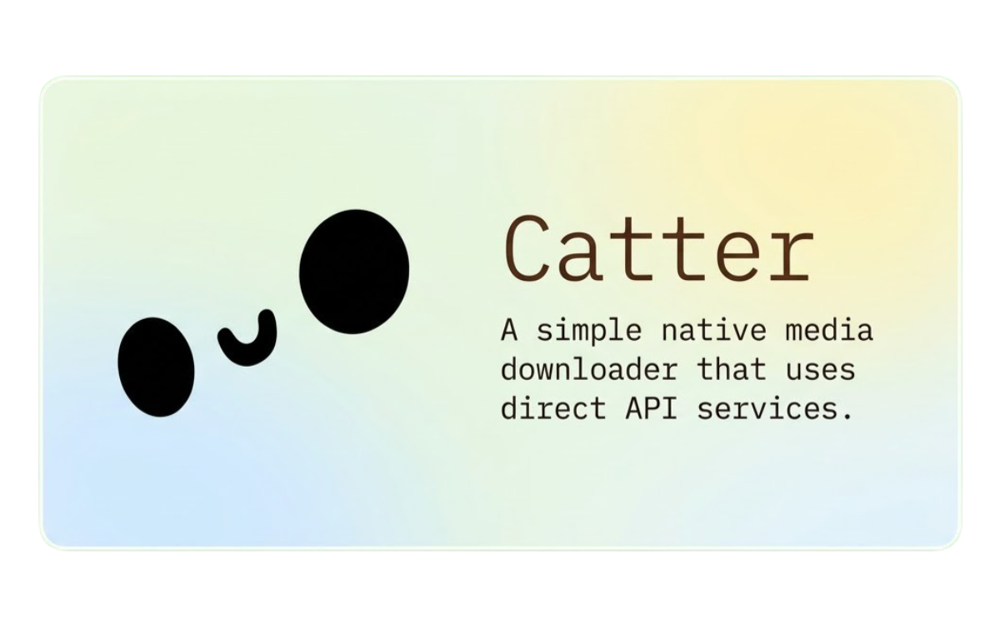

<p align="center">
  
</p>

# Catter

A small native media downloader for Android. Paste a link, pick a format, done.

Built with Kotlin and Jetpack Compose, Material 3 styling, and a minimal single screen flow.

## Features

- YouTube, YouTube Music, Instagram, TikTok, Pinterest, Reddit and X are supported today, and more services may be added later
- YouTube videos in MP4 up to 1080p, audio in MP3 up to 320 kbps
- Instagram videos, photos and carousels in their original quality
- TikTok videos and photo carousels in their original quality
- Pinterest videos, photos and carousels in their original quality
- Reddit videos, images and galleries in their original quality
- X videos in MP4 with audio
- Single posts download straight away, multi media posts show every item with a download all action
- Sequential download queue with per item cancel, so you can keep pasting links while it works
- Preview with title, author and thumbnail before downloading
- Files saved to Downloads with clean names, sorted into videos, audios and photos, with duplicate handling
- Material You, AMOLED black, and system, light or dark themes

## Requirements

- Android 7.0 (API 24) or newer
- Internet connection
- Storage write permission only on Android 9 and below

## Build

Open the project in Android Studio and run it, or use the Gradle wrapper:

```
./gradlew assembleDebug
```

## Tech

- Kotlin, Jetpack Compose, Material 3
- Kotlin coroutines
- DM Mono font
- Tabler Icons, bundled as a local module

## Notes

This is a personal project. It was made purely out of personal interest, for my own use, and I fix and maintain everything myself. It is not a product, there is no roadmap, and support is whatever I can manage on my own time.

Use it only for content you have the right to download.

## Credits

- xzyyysh (me)
